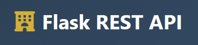
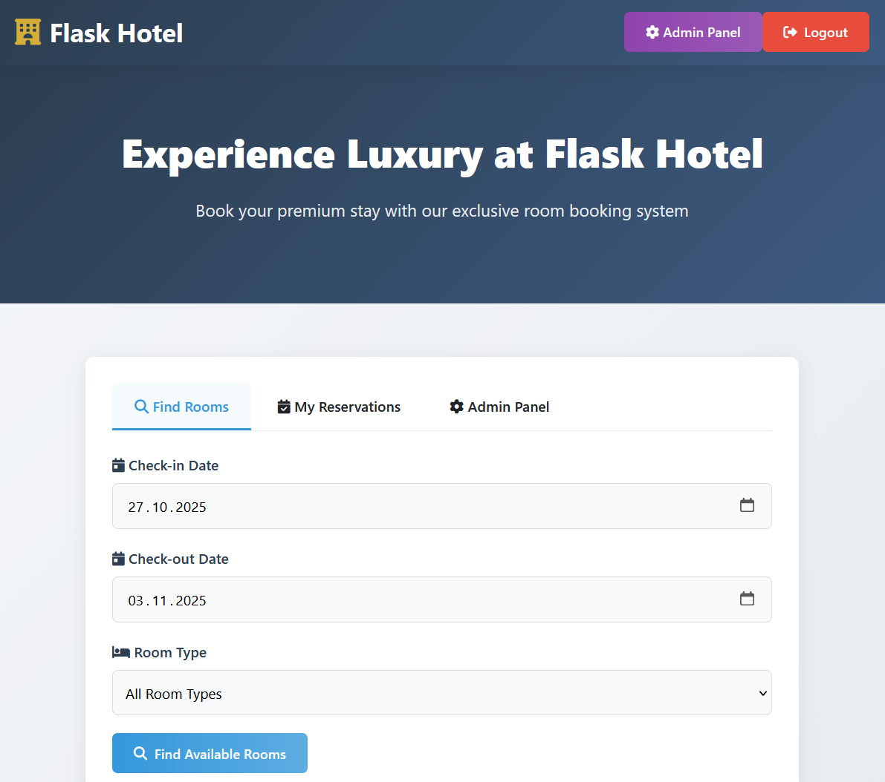

<p align="center">
  
</p>

<p align="center"><b>Kompletny system rezerwacji hotelowej z backendem REST API we Flask i responsywną SPA</b></p>

---

## 🛠️ Technologie
| Warstwa | Technologie                |
|----------|----------------------------|
| **Backend** | Flask, Python 3, JWT, SQL  |
| **Frontend** | HTML, CSS, JavaScript, SPA |

---

## 🚀 Funkcjonalności

### 🧩 Backend (Flask REST API)

- 🔐 **System rejestracji i logowania** użytkowników z hashowaniem haseł
- 🛡️ **Autoryzacja JWT** z tokenami dostępu
- ✅ **Walidacja danych wejściowych** na wszystkich endpointach (własne dekoratory)
- 🏨 **Wyszukiwanie dostępnych pokoi** w wybranym okresie czasowym
- 📅 **System rezerwacji** z walidacją dat i dostępności:
    - tworzenie nowych rezerwacji
    - pobieranie własnych rezerwacji
    - anulowanie rezerwacji
- 🗃️ **Przechowywanie danych w bazie danych** - zapytania SQLAlchemy (RAW SQL)
- 🎯 **Kontrola dostępu** oparta na rolach (użytkownik/administrator)
- 👨‍💼 **Panel administratora** do zarządzania pokojami i rezerwacjami:
    - dodawanie nowych pokoi
    - zmiana statusu aktywności pokoju
    - podgląd wszystkich rezerwacji i pokoi
- 🧪 **Testowanie endpointów (requests)** przy pomocy skryptu requests_to_api.py
  
### 🎨 Frontend

- 🧠 Wygenerowany przez **AI** i ręcznie dostosowany przeze mnie 
- 🧭 Architektura **SPA** (pojedynczy plik .html z CSS i JS)
- 📱 Responsywny design

---

## 🖼️ Screenshot

<p align="center">
  
</p>


---

## ⚙️ Instrukcja uruchomienia

**1️⃣ Sklonuj repozytorium:**
```
git clone https://github.com/jakubwprojects/JW_FLASK_REST_API.git
cd JW_FLASK_REST_API
```

**2️⃣ Utwórz i aktywuj środowisko wirtualne (opcjonalnie):**
```
python -m venv .venv
```
Windows:
```
.venv\Scripts\activate
```
Linux / Mac:
```
source .venv/bin/activate
```

**3️⃣ Zainstaluj wymagane pakiety:**
```
pip install -r requirements.txt
```

**4️⃣ Uruchom serwer lokalnie:**
```
python app.py
```

**5️⃣ Wejdź w przeglądarce pod adres: 👉 http://127.0.0.1:5000/**

**6️⃣ Testowe konto administratora:**

- Login: `admin`
- Hasło: `1234`

---

## 🔌 Endpointy API

> 🔒 Wszystkie endpointy poza /api/register i /api/login wymagają ważnego JWT Access Tokena w nagłówku:

> Authorization: Bearer <twój_token>

> 📅 Wszystkie daty w formacie `YYYY-MM-DD`

### 👤 Endpointy użytkownika
| Metoda | Endpoint | Opis                         | Wymagane dane                                          |
|--------|----------|------------------------------|--------------------------------------------------------|
| `POST` | `/api/register` | Rejestracja                  | `name`, `last_name`, `email`, `password`               |
| `POST` | `/api/login` | Logowanie                    | `email`, `password`                                    |
| `GET` | `/api/rooms` | Szukanie pokoi               | query params: `start_date`, `end_date`, `type (optional)` |
| `POST` | `/api/reservations` | Rezerwacja                   | `room_id`, `start_date`, `end_date`         |
| `GET` | `/api/reservations` | Moje rezerwacje              | -                                                      |
| `DELETE` | `/api/reservations/<id>` | Anulowanie swojej rezerwacji | -                                                      |
| `GET` | `/api/users/role` | Sprawdzenie roli             | -                                                      |

### 👨‍💼 Endpointy administratora
| Metoda | Endpoint | Opis                           | Wymagane dane |
|--------|----------|--------------------------------|---------------|
| `GET` | `/api/rooms/all` | Wszystkie pokoje               | - |
| `POST` | `/api/rooms` | Dodaj pokój                    | `type`, `price` |
| `PATCH` | `/api/rooms/<id>` | Status pokoju                  | `active` (boolean) |
| `GET` | `/api/reservations/all` | Wszystkie rezerwacje           | - |
| `DELETE` | `/api/reservations/<id>` | Anulowanie dowolnej rezerwacji | -

---

## ✍️ Autor

**Jakub W**  

✉️ **[jakubw.devmail@gmail.com](mailto:jakubw.devmail@gmail.com)**  

---